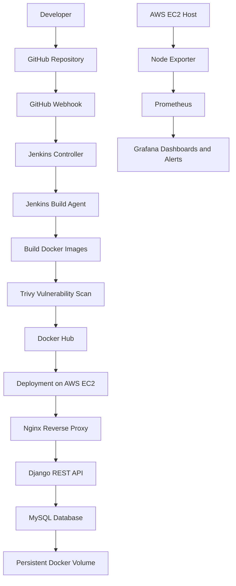

# NexaVault — Multi-User Knowledge & Productivity Platform

**A full-stack application deployed using Docker, automated with Jenkins CI/CD, and monitored using Prometheus and Grafana on AWS EC2.**


## 📌 Project Overview

NexaVault is a full-stack knowledge and productivity application designed to help users manage their personal notes through a web interface.

The project goes beyond application development by implementing practical DevOps workflows for containerization, continuous integration and delivery, cloud deployment, and infrastructure monitoring.

The application uses **React** for the frontend, **Django REST Framework** for the backend API, **MySQL** for persistent data storage, and **Nginx** as the web server and reverse proxy. Docker Compose manages the application containers, while Jenkins automates the build and deployment workflow on AWS EC2.

Prometheus, Node Exporter, and Grafana provide infrastructure monitoring and visualization.

**Primary objective:** Build and operate an application using real-world cloud and DevOps practices, from source code to deployment and monitoring.

## 🎯 Key Features

- **Full-stack application:** React frontend integrated with a Django REST API.
- **Containerized deployment:** Application services packaged as Docker images.
- **Multi-container orchestration:** Docker Compose manages the web server, backend, and database services.
- **Reverse proxy:** Nginx handles incoming HTTP requests and routes application traffic.
- **Automated CI/CD:** Jenkins automates source checkout, image builds, security scanning, image publishing, and deployment.
- **Cloud infrastructure:** Application hosted on Ubuntu-based AWS EC2 infrastructure within a custom VPC.
- **Persistent database storage:** MySQL data stored using a Docker named volume.
- **Container health checks:** Health checks help identify unhealthy services.
- **Security scanning:** Trivy scans container images for vulnerabilities.
- **Infrastructure monitoring:** Prometheus collects metrics from Node Exporter.
- **Visualization and alerting:** Grafana dashboards visualize monitoring metrics, with a high-CPU alert configured.

## 🛠️ Technology Stack

| Category | Technologies |
|---|---|
| Frontend | React, JavaScript |
| Backend | Python, Django, Django REST Framework |
| Database | MySQL 8.4 |
| Web server | Nginx |
| Containerization | Docker, Docker Compose |
| CI/CD | Jenkins, Jenkins Controller-Agent |
| Container registry | Docker Hub |
| Security scanning | Trivy |
| Cloud platform | AWS EC2, VPC, Security Groups |
| Infrastructure monitoring | Prometheus, Node Exporter |
| Dashboards and alerting | Grafana |
| Version control | Git, GitHub |

## 🏗️ Architecture



### Architecture Explanation

1. **Source code management:** Application code is maintained in GitHub.
2. **Pipeline triggering:** A GitHub webhook triggers the Jenkins pipeline when configured repository events occur.
3. **Build and security checks:** Jenkins checks out the source code, builds Docker images, and runs Trivy vulnerability scans.
4. **Image publishing:** Docker images are pushed to Docker Hub.
5. **Application deployment:** The deployment workflow updates and runs the application containers on AWS EC2 using Docker Compose.
6. **Request handling:** Nginx receives HTTP requests and forwards application requests to the Django backend.
7. **Data persistence:** MySQL stores application data in a persistent Docker volume.
8. **Monitoring:** Node Exporter exposes host metrics, Prometheus collects them, and Grafana displays dashboards and evaluates configured alerts.

*Note: The diagram describes the implemented application and monitoring workflow at a high level. The precise pipeline sequence and deployment commands are defined by the Jenkinsfile and Docker Compose configuration in the repository.*

## 🔄 CI/CD Pipeline

The Jenkins pipeline automates the delivery process to reduce repetitive manual deployment work.

### Pipeline workflow

1. **Developer pushes code** to GitHub.
2. **GitHub webhook triggers Jenkins** for configured repository events.
3. **Jenkins checks out the latest source code.**
4. **Docker images are built** for the application services.
5. **Trivy scans the images** for security vulnerabilities.
6. **Images are pushed to Docker Hub** using configured Jenkins credentials.
7. **Deployment commands update the running application** using Docker Compose on the target EC2 environment.
8. **Application health is checked** through configured container health checks.

### Jenkins Controller-Agent Architecture

The Jenkins controller manages the pipeline, while a separate Jenkins agent performs build and deployment tasks.

This separation demonstrates distributed Jenkins execution and allows build workloads to run independently of the controller.

### Security Considerations

- Docker Hub credentials are stored in Jenkins Credentials rather than hardcoded into the pipeline.
- Environment-specific secrets should be supplied through protected configuration.
- Trivy provides visibility into container image vulnerabilities.
- Production deployments should enforce appropriate vulnerability thresholds and fail the pipeline when required security checks do not pass.

## 📊 Monitoring and Observability

NexaVault includes a separate monitoring stack built with Prometheus, Node Exporter, and Grafana.

### Prometheus

- Collects metrics from configured monitoring targets.
- Uses PromQL to query and analyze time-series data.
- Tracks target availability through metrics such as `up`.
- Supports CPU utilization analysis using Node Exporter metrics.

### Node Exporter

- Exposes Linux host metrics.
- Provides CPU, memory, filesystem, and other system-level measurements.
- Supplies metrics for Prometheus collection.

### Grafana

- Visualizes collected metrics through dashboards.
- Supports CPU monitoring and other infrastructure panels.
- Includes a configured high-CPU alert rule and an alert contact point.

**Alerting note:** An alert rule and contact point have been configured. Actual email notification delivery requires a working notification integration and SMTP configuration, which should be treated separately from alert-rule creation.

## ☁️ AWS Infrastructure

The application is deployed on Ubuntu-based Amazon EC2 instances within an AWS Virtual Private Cloud.

The infrastructure work includes:

- Custom VPC and subnet configuration.
- Internet Gateway and routing for public connectivity where configured.
- Security Groups for controlling network access.
- EC2 instances for application and Jenkins workloads.
- Docker-based application deployment.
- AWS-hosted CI/CD infrastructure using a Jenkins controller and agent.

Infrastructure components such as an Application Load Balancer, Auto Scaling Group, and multi-Availability-Zone application deployment should be listed as implemented only after they have been provisioned and tested.

## 🚀 Getting Started

### Prerequisites

Install the following tools before running the project locally:

- Git
- Docker Engine or Docker Desktop
- Docker Compose
- A web browser

### 1. Clone the repository

```bash
git clone https://github.com/Suraj-dot-wq/Personal-Notes-App.git
cd Personal-Notes-App
```

### 2. Configure environment variables

Review the Django settings and Docker Compose configuration to identify the required environment variables.

Configure the application and MySQL credentials in the appropriate local environment file. Use the variable names expected by the repository's configuration.

Do not commit real passwords, secret keys, or production credentials to GitHub.

### 3. Start the application

From the directory containing the project's Compose configuration, run:

```bash
docker compose up -d --build
```

Check the running containers:

```bash
docker compose ps
```

View service logs:

```bash
docker compose logs -f
```

### 4. Access the application

Open the following address if the Compose configuration publishes Nginx on host port 80:

```text
http://localhost
```

If the application uses a different port mapping, use the configured host port instead.

### 5. Stop the application

```bash
docker compose down
```

**Data persistence:** The MySQL named volume is intended to retain database data when containers are stopped or recreated. Removing a container does not, by itself, remove a named volume. Avoid deleting volumes unless you intend to remove their stored data.

## 📁 Repository Structure

The repository contains the application source code and deployment configuration. The exact directory structure may evolve as the project develops.

```text
Personal-Notes-App/
├── frontend/                 # React application, if organized separately
├── backend/                  # Django application, if organized separately
├── Dockerfile                # Application image build configuration
├── docker-compose.yml        # Multi-container configuration
├── Jenkinsfile               # CI/CD pipeline definition
├── nginx/                    # Nginx configuration, if separated
├── requirements.txt          # Python dependencies, if present
└── README.md                 # Project documentation
```

*The names above are illustrative. Adjust this tree to match the actual paths and filenames in the repository before publishing.*

## 🔐 Security and Operational Practices

- Keep credentials outside source control.
- Use Jenkins credential management for registry authentication.
- Restrict public inbound ports through AWS Security Groups.
- Expose only the ports required by each service.
- Avoid publicly exposing MySQL, Prometheus, Grafana, or other internal services without appropriate access controls.
- Scan container images and review vulnerability findings.
- Use persistent storage for important application data.
- Monitor disk space, CPU, memory, and container health.
- Configure and test backups and recovery procedures for production workloads.

## 🧠 Key Learning Outcomes

This project provides hands-on experience with:

- Building a CI/CD pipeline using Jenkins.
- Understanding Jenkins controller-agent architecture.
- Containerizing a multi-service application with Docker.
- Managing application services using Docker Compose.
- Publishing and deploying container images through Docker Hub.
- Deploying applications on AWS EC2 and configuring VPC networking.
- Using Nginx as a reverse proxy.
- Persisting database data using Docker volumes.
- Scanning container images with Trivy.
- Collecting infrastructure metrics with Prometheus and Node Exporter.
- Building Grafana dashboards and configuring alert rules.
- Troubleshooting deployment, networking, container, and monitoring issues.

## 🔮 Future Improvements

Potential next steps include:

- Provisioning infrastructure reproducibly using Terraform.
- Deploying the application behind an Application Load Balancer.
- Implementing an Auto Scaling Group across multiple Availability Zones.
- Adding automated tests and stricter CI/CD quality gates.
- Configuring HTTPS with managed TLS certificates.
- Implementing tested database backup and restore procedures.
- Configuring and verifying email or other alert notification delivery.
- Improving secrets management and least-privilege access.
- Adding application-level metrics and centralized logging.

These are future improvements unless explicitly implemented in the current environment.

## 👨‍💻 Author

**Ghadage Suraj Ganpat**

Computer Science and Design Engineering student interested in Cloud Computing, DevOps, AWS Infrastructure, CI/CD Automation, and Observability.

- GitHub: [Suraj-dot-wq](https://github.com/Suraj-dot-wq)
- Project Repository: [NexaVault — Personal Notes App](https://github.com/Suraj-dot-wq/Personal-Notes-App)

---

⭐ If you find this project useful, feel free to explore the repository and its deployment configuration.
